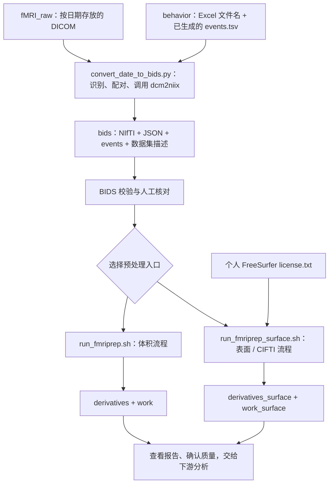

# MindShape 触觉 fMRI 预处理工作流

将联影（UIH）扫描仪导出的 DICOM 与已有的行为事件文件整理为 BIDS 数据集，再通过
Docker 运行固定版本的 fMRIPrep，得到供后续分析使用的体积、皮层表面或 CIFTI 时间序列。

本项目是**面向 MindShape 触觉实验目录和命名约定的脚本工作流**，覆盖“数据整理 → BIDS 转换 →
预处理 → 质量检查”。行为事件生成、GLM/GLMsingle 拟合、统计检验和组水平分析由外部流程
完成；更换扫描协议或实验命名时，应先适配转换规则。

## 目录

- [1. 项目架构与完整数据流](#1-项目架构与完整数据流)
- [2. 目录和文件职责](#2-目录和文件职责)
- [3. 输入数据与匹配规则](#3-输入数据与匹配规则)
- [4. 环境准备](#4-环境准备)
- [5. 全流程操作](#5-全流程操作)
- [6. 输出文件与下游交接](#6-输出文件与下游交接)
- [7. 参数速查](#7-参数速查)
- [8. 已知边界与排错](#8-已知边界与排错)

## 1. 项目架构与完整数据流

项目由一个 Python 转换程序和两个可选的 Bash 预处理入口组成，没有统一的一键调度器。
Windows 批处理文件只负责启动 Python 程序。



各阶段通过磁盘文件衔接：

| 阶段 | 主要工作 | 输入 → 输出 | 执行方式 |
| --- | --- | --- | --- |
| 输入准备 | 整理扫描序列，准备行为记录和事件表 | DICOM、行为文件 → 约定的输入目录 | 人工准备；事件生成由外部流程完成 |
| BIDS 转换 | 确定被试/session/run，转换影像、复制事件、修订元数据 | `fMRI_raw/` + `behavior/` → `bids/` | 本文以 Windows + Python 为例 |
| fMRIPrep 预处理 | 调用 Docker 中的 fMRIPrep `25.2.5` | `bids/` → 结果、报告、中间文件 | Linux 或 WSL2 + Docker |
| 质量检查 | 检查配准、校正和头动，确认下游输入 | 报告与结果 → 分析输入 | 人工检查；统计分析在本项目之外 |

**两个预处理脚本是并列的选择。** 表面流程不需要先运行体积流程，它本身也请求体积输出。
如果需要分别运行两种配置，使用各自的输出和工作目录。

## 2. 目录和文件职责

下面是代码与运行数据的逻辑布局。原始数据和行为记录由使用者自行准备，处理结果由运行生成；
这些数据不包含在仓库中。输入输出根目录可配置到其他位置。

```text
fMRIprep_prep_code/
├── README.md                          # 架构和端到端使用说明
├── .gitignore                         # 排除本地数据和运行产物
├── .gitattributes                     # 跨平台文本换行约定
├── run_fmriprep.sh                    # 体积预处理入口
├── run_fmriprep_surface.sh            # 体积 + 表面 + CIFTI 入口
├── bids/
│   ├── code/                         # DICOM → BIDS 转换工具
│   │   ├── convert_date_to_bids.py    # 转换主程序
│   │   ├── run_bids_convert.bat       # Windows 启动入口
│   │   └── README_BIDS_convert.md     # 转换阶段的操作速查
│   ├── dataset_description.json      # 数据集描述；缺失时创建
│   ├── participants.tsv              # 被试列表；补齐缺失被试
│   └── sub-<ID>/ses-<ID>/             # 生成的 anat、func、fmap 数据
├── fMRI_raw/                         # 本地输入：原始 DICOM
├── behavior/                         # 本地输入：Excel 和事件表
├── license.txt                       # 本地配置：个人 FreeSurfer 许可证
├── derivatives/                      # 体积流程的结果与报告
├── work/                             # 体积流程的中间文件；运行时创建
├── derivatives_surface/              # 表面流程的结果与报告
├── work_surface/                     # 表面流程的中间文件；运行时创建
└── output/                           # 本地汇报材料；不参与处理流程
```

### 可执行文件

| 文件 | 职责和实际动作 | 与其他文件的关系 |
| --- | --- | --- |
| `bids/code/run_bids_convert.bat` | 优先使用 `py -3`，不可用时回退到 `python`；原样转交参数和退出码 | 只启动同目录下的 Python 主程序，不定义转换规则 |
| `bids/code/convert_date_to_bids.py` | 扫描日期目录、建立 task/run 配对、调用 dcm2niix、复制 events、更新 JSON 和被试表 | 消费原始影像与行为文件，生成 fMRIPrep 所需的 BIDS 输入 |
| `run_fmriprep.sh` | 检查输入、组装参数和挂载目录，启动体积预处理；禁用 `recon-all` | 只读取 BIDS 数据，不调用转换程序或表面脚本 |
| `run_fmriprep_surface.sh` | 启动含 FreeSurfer 重建、表面和 CIFTI 输出的预处理 | 读取同类 BIDS 输入，另需个人许可证；不依赖体积脚本的结果 |

### 配套文件和数据格式

| 文件类型 | 保存什么 | 谁提供或生成 |
| --- | --- | --- |
| 行为 `.xlsx` | 当前程序只使用文件名中的被试、日期、session 和 run | 实验采集/行为流程 |
| `*_events.tsv` | 任务事件；程序复制内容，不生成或校验试次 | 外部行为处理流程；静息态仅生成空表头 |
| `.nii.gz` | 影像数据 | 转换阶段由 dcm2niix 生成，预处理阶段由 fMRIPrep 生成派生影像 |
| 影像配套 `.json` | 扫描参数和元数据，例如 `TaskName`、EchoTime 和场图关联 | dcm2niix 生成，转换程序补充或修订部分字段 |
| `dataset_description.json` | 数据集名称、BIDS 版本和类型 | 缺失时由转换程序创建；已有文件不覆盖 |
| `participants.tsv` | 被试列表及属性 | 转换程序追加缺失被试，属性默认 `n/a` |
| `license.txt` | 个人 FreeSurfer 使用许可 | 使用者自行申请；与项目代码许可证不同 |
| HTML 报告和日志 | 质量检查图与运行记录 | fMRIPrep 生成 |

### 转换程序内部结构

需要适配命名或转换规则时，可按以下顺序阅读 `convert_date_to_bids.py`：

| 环节 | 主要函数 / 数据结构 | 作用 |
| --- | --- | --- |
| 参数与日期 | `parse_args()`、`normalize_dates()` | 选择根目录和日期；默认取最新日期目录 |
| 输入识别 | `normalize_sub_id()`、`discover_behavior_runs()`、`classify_series()` | 识别被试、读取行为文件名、分类扫描序列 |
| 计划与检查 | `BehaviorRun`、`SubjectPlan`、`build_plans()` | 检查数量、session 和重复目录，建立配对计划 |
| 影像转换 | `convert_series()` | 调用 dcm2niix；每个序列须恰好产生一份 NIfTI 和一份 JSON |
| 元数据与事件 | `sanitize_non_bold_json()`、`update_phasediff_json()`、`copy_events()` | 修订 sidecar、关联场图、复制任务事件 |
| 数据集写入 | `ensure_dataset_description()`、`ensure_participants()`、`process_plan()`、`main()` | 维护数据集信息并执行各被试计划 |

## 3. 输入数据与匹配规则

### 3.1 原始影像

```text
fMRI_raw/
└── 20260708/
    └── scan_sub001_093000/
        ├── bold_task1.../          # 每个目录放一个序列的 DICOM
        ├── bold_task2.../
        ├── bold_rest.../           # 可选
        ├── t1_mprage.../
        ├── fieldmap_echo1.../
        ├── fieldmap_echo2.../
        └── fieldmap_b0map.../
```

日期目录使用八位数字 `YYYYMMDD`。被试目录名应含编号，例如 `sub001`；程序也接受
`sub-001`、`sub_001`，统一输出为 `sub-001`。序列分类只检查被试目录的**直接子目录名称**，
忽略大小写：

| 目录识别规则 | BIDS 输出 | 选择规则 |
| --- | --- | --- |
| 以 `bold` 开头，含 `taskN` | `func/*_task-tactile_run-<ID>_bold.*` | 按 `N` 数值升序排列 |
| 以 `bold` 开头，含 `rest` | `func/*_task-rest[_run-<ID>]_bold.*` | 一个静息序列不写 run；多个按目录名排序，从 `01` 编号 |
| 以 `t1_mprage` 开头 | `anat/*_T1w.*` | 多个匹配时只使用按目录名排序后的第一个 |
| 以 `fieldmap` 开头，含 `echo1` | `fmap/*_magnitude1.*` | 多个匹配时只使用第一个 |
| 以 `fieldmap` 开头，含 `echo2` | `fmap/*_magnitude2.*` | 多个匹配时只使用第一个 |
| 以 `fieldmap` 开头，含 `b0map` | `fmap/*_phasediff.*` | 按本项目的 phasediff 约定处理 |

程序不自动判断场图物理类型，也不会把任意 `b0map` 数值转换为相位差。
更换扫描协议时，需要核对影像含义、单位与 JSON 元数据。

### 3.2 行为记录和事件表

```text
behavior/
└── sub-001/
    ├── sub-001_ses-02_task-tactile_run-05_20260708_100705.xlsx
    ├── sub-001_ses-02_task-tactile_run-05_events.tsv
    ├── sub-001_ses-02_task-tactile_run-06_20260708_101500.xlsx
    └── sub-001_ses-02_task-tactile_run-06_events.tsv
```

Excel 文件名必须符合：

```text
sub-<数字>_ses-<数字>_task-tactile_run-<数字>_YYYYMMDD_HHMMSS.xlsx
```

**程序只读取 Excel 文件名，不打开工作簿内容。** 文件名提供日期、session 和 run；
`events.tsv` 必须提前生成。事件时间单位、与扫描起点的对齐和试次内容由使用者确认，
当前程序只复制文件，不检查或修正事件内容。

每个 run 的事件文件按以下顺序查找：

1. `<被试_session_task_run>_events.tsv`。
2. `<被试_session_task_run>_events_YYYYMMDD_HHMMSS.tsv`。
3. 同一前缀的其他 `_events*.tsv` 文件，按文件名排序取第一个。

为避免选到旧版本，建议每个 run 保留一份明确命名的事件表。

### 3.3 DICOM 与行为 run 如何配对

同一被试同一天，任务 DICOM 按 `taskN` 数值排序，行为记录按 run 数值排序，随后逐项配对：

| DICOM 序列 | 当天行为记录 | BIDS 名称 |
| --- | --- | --- |
| `bold_task1...` | `ses-02/run-05` | `sub-001_ses-02_task-tactile_run-05_bold.*` |
| `bold_task2...` | `ses-02/run-06` | `sub-001_ses-02_task-tactile_run-06_bold.*` |

`task1` 不一定等于 `run-01`。程序不通过扫描时间或 Excel 内容验证配对，
正式转换前需检查 `--dry-run` 打印的对应关系。

当前约束：

- 同一被试同一天只能有一个原始被试目录，不自动合并重复扫描目录。
- 当天任务序列数必须与匹配到的行为 Excel 数量相同，且这些行为记录只属于一个 session。
- 没有行为 run 的纯结构像/静息态数据默认进入 `ses-01`，不从日期推断 session。
- session 和 run 编号至少两位，不截断三位编号，例如 `ses-100/run-101` 可以保留。

## 4. 环境准备

| 阶段 | 工具 | 说明 |
| --- | --- | --- |
| BIDS 转换 | Python 3.10+、[dcm2niix](https://github.com/rordenlab/dcm2niix) | Python 程序仅使用标准库，无需第三方 Python 包 |
| 预处理 | Linux/WSL2、Bash、可用的 Docker 服务 | 固定镜像 `nipreps/fmriprep:25.2.5` |
| 表面/CIFTI 分支 | 个人 FreeSurfer license | 放在 `FS_LICENSE` 指向的位置；体积脚本不需要 |
| 输入校验 | [BIDS Validator](https://github.com/bids-standard/bids-validator) | 仓库未附带校验器，需自行准备 |

Windows PowerShell 中检查：

```powershell
python --version
dcm2niix --version
```

dcm2niix 不在 `PATH` 时，通过 `--dcm2niix` 指定可执行文件绝对路径。
只运行 `--dry-run` 时，不要求 dcm2niix 可用。

Linux/WSL2 中检查 Docker 并拉取镜像：

```bash
docker --version
docker pull nipreps/fmriprep:25.2.5
docker run --rm nipreps/fmriprep:25.2.5 --version
```

表面分支需到 [FreeSurfer 注册页面](https://surfer.nmr.mgh.harvard.edu/registration.html)
申请个人许可证。首次运行还需允许 fMRIPrep 获取所需模板，或预先准备相应缓存。

## 5. 全流程操作

### 步骤 1：准备输入

按第 3 节准备 DICOM、行为 Excel 和已有事件表。建议先处理一个日期，确认匹配关系与配置后
再扩大范围。以下路径、日期和被试均为示例，请替换为实际值。

### 步骤 2：在 Windows 上预览转换计划

在 PowerShell 中进入项目根目录：

```powershell
$repo = (Get-Location).Path
$convertArgs = @(
  '--raw-root', (Join-Path $repo 'fMRI_raw'),
  '--behavior-root', (Join-Path $repo 'behavior'),
  '--bids-root', (Join-Path $repo 'bids'),
  '--date', '20260708'
)

& "$repo\bids\code\run_bids_convert.bat" @convertArgs --dry-run
```

检查被试、session、`taskN->run-XX`、静息序列数量和缺失序列警告。
`--dry-run` 不写入文件，也不运行 dcm2niix，不能验证真实转换结果或事件内容。

这里显式传入三个根目录，因为程序内置默认值仍为 `H:\lcy_data\...`，
**不会自动以仓库所在位置作为数据根目录**。

### 步骤 3：执行 BIDS 转换

在同一个 PowerShell 窗口中沿用上一步变量：

```powershell
& "$repo\bids\code\run_bids_convert.bat" @convertArgs
```

需要指定 dcm2niix 时：

```powershell
& "$repo\bids\code\run_bids_convert.bat" @convertArgs `
  --dcm2niix 'D:\tools\dcm2niix\dcm2niix.exe'
```

转换程序会：

- 调用 dcm2niix，将影像和 JSON 写入 `anat/`、`func/`、`fmap/`。
- 为 BOLD 设置 `TaskName`，复制任务事件；为静息态写入只有表头的事件文件。
- 三件场图齐备时，在 `phasediff.json` 中写入 `IntendedFor`，关联本次计划内的功能像；
  缺失 `EchoTime1/2` 时尝试从 magnitude JSON 的 `EchoTime` 补齐。
- 从 T1w/场图 JSON 中移除代码列出的非 BOLD 读出字段：`TotalReadoutTime`、
  `EffectiveEchoSpacing`、`DerivedVendorReportedEchoSpacing`、`BandwidthPerPixelPhaseEncode`。
- 缺失时创建 `dataset_description.json`（写入 `BIDSVersion: 1.8.0`），向
  `participants.tsv` 追加缺失被试，其他属性填 `n/a`；已有数据集描述不覆盖。

默认跳过已完整存在的 NIfTI/JSON 对和已有事件表，但**仍可能修订已有 JSON 元数据**。
需要重新生成影像或复制新事件时才使用 `--overwrite`，该选项会替换目标文件。

### 步骤 4：检查 BIDS 数据集

典型输出如下；每个 `.{nii.gz,json}` 表示同名前缀的两份文件：

```text
bids/
├── code/
├── dataset_description.json
├── participants.tsv
└── sub-001/
    └── ses-02/
        ├── anat/
        │   └── sub-001_ses-02_T1w.{nii.gz,json}
        ├── fmap/
        │   ├── sub-001_ses-02_magnitude1.{nii.gz,json}
        │   ├── sub-001_ses-02_magnitude2.{nii.gz,json}
        │   └── sub-001_ses-02_phasediff.{nii.gz,json}
        └── func/
            ├── sub-001_ses-02_task-tactile_run-05_bold.{nii.gz,json}
            ├── sub-001_ses-02_task-tactile_run-05_events.tsv
            ├── sub-001_ses-02_task-tactile_run-06_bold.{nii.gz,json}
            └── sub-001_ses-02_task-tactile_run-06_events.tsv
```

使用 [BIDS Validator](https://github.com/bids-standard/bids-validator) 检查输出，处理错误并
审阅警告。同时人工确认事件与 run 对应、BOLD 的 TR/相位编码等元数据、场图 EchoTime 和
关联路径。目录正确或打印 `Done.` 都不能代替这些检查。

转换程序不内置校验器；两个预处理脚本也没有关闭 fMRIPrep 的输入校验。
输入要求见 [fMRIPrep 25.2.5 使用说明](https://fmriprep.org/en/25.2.5/usage.html)。

### 步骤 5：准备 Linux/WSL2 运行目录

将**完整的 `bids/`**、所需 `.sh` 和表面分支需要的个人许可证放到 Linux 运行目录，例如：

```text
~/lcy_data/
├── bids/
├── run_fmriprep.sh
├── run_fmriprep_surface.sh
└── license.txt                  # 仅表面分支需要
```

WSL2 下可将数据复制到 Linux 文件系统中运行。`fMRI_raw/`、`behavior/` 和 `.bat` 不需要
复制到这个目录，因为 fMRIPrep 只读取转换后的 BIDS 数据。

### 步骤 6：选择分支并修改配置

| 配置 | `run_fmriprep.sh` | `run_fmriprep_surface.sh` |
| --- | --- | --- |
| 输出空间 | `T1w`、`MNI152NLin2009cAsym:res-2` | 左侧两种 + `fsnative`、`fsaverage5` |
| FreeSurfer 重建 | 通过 `--fs-no-reconall` 禁用 | 启用，需要个人许可证 |
| CIFTI | 不请求 | `--cifti-output 91k` |
| 最终输出 | `derivatives/` | `derivatives_surface/` |
| 中间文件 | `work/` | `work_surface/` |
| 当前资源配置 | 总线程上限 12、单进程线程上限 8、90000 MB | 总线程上限 12、单进程线程上限 8、60000 MB |

资源值是当前脚本配置，不是硬件最低要求。每次处理一个被试；`SESSIONS=()` 表示该被试的
全部 session。打开所选脚本顶部配置区，至少修改：

```bash
SUBJECT="001"                       # 不带 sub- 前缀
SESSIONS=("02")                    # 不带 ses- 前缀；全部 session 写 ()
PROJECT_DIR="${HOME}/lcy_data"
BIDS_DIR="${PROJECT_DIR}/bids"
```

**两个脚本的路径都需要检查。** 尤其表面脚本当前将 `BIDS_DIR` 独立写为 Windows 盘的 WSL
挂载路径，不随 `PROJECT_DIR` 自动变化；采用上述布局时应改成示例写法。
配置通过编辑脚本完成，`.sh` 没有实现命令行参数解析。

`ANAT_REFERENCE` 当前为 `unbiased`，`USE_SYN_SDC` 当前为 `false`。有完整且可用的场图时
沿用场图配置；需要无场图后备校正时可设 `USE_SYN_SDC=true`，追加 `--use-syn-sdc warn`。
该选项不会修复错误的场图，也不代表强制覆盖场图选择。

### 步骤 7：运行预处理

在交互终端中进入 Linux 运行目录，执行所选分支：

```bash
cd ~/lcy_data
bash -n run_fmriprep.sh
bash run_fmriprep.sh
```

表面/CIFTI 分支改为：

```bash
cd ~/lcy_data
bash -n run_fmriprep_surface.sh
bash run_fmriprep_surface.sh
```

脚本先检查 Docker 命令、BIDS 目录、数据集描述和被试目录；表面脚本额外检查许可证非空。
然后创建结果和工作目录，并挂载到容器：

| 主机目录 / 文件 | 容器位置 | 用途 |
| --- | --- | --- |
| `BIDS_DIR` | `/data`，只读 | 输入数据 |
| `OUTPUT_DIR` | `/out`，可写 | 预处理结果与报告 |
| `WORK_DIR` | `/work`，可写 | 中间文件和缓存 |
| `FS_LICENSE`，仅表面分支 | `/opt/freesurfer/license.txt`，只读 | FreeSurfer 许可 |

脚本使用 `docker run --rm -it`，适合交互终端启动。当前不自动遍历全部被试；下一个被试需
修改 `SUBJECT` 后重新运行。批处理/集群提交需另行适配终端与资源配置。

### 步骤 8：检查报告，交给下游分析

查看输出根目录的 HTML 报告，包括可能分开的 `sub-<ID>_anat.html` 和
`sub-<ID>_ses-<ID>_func.html`。重点检查脑提取、BOLD 与结构像配准、标准空间配准和畸变
校正，结合头动和混杂变量评估各 run 的质量。

确认所需输出齐全并通过质量检查后再进入下游分析。保留运行配置、输入版本、报告和日志；
在排错或需要续跑期间保留工作目录。

## 6. 输出文件与下游交接

以下为常见文件模式，实际路径以本次输出为准。体积分支位于 `derivatives/`，表面分支位于
`derivatives_surface/`。

| 文件 / 目录 | 内容与用途 |
| --- | --- |
| `sub-*/.../anat/` | 处理后的结构像、分割和变换，用于结构参考、掩膜与空间转换 |
| `*_desc-preproc_bold.nii.gz` | 指定空间的预处理 BOLD，按 `space-` 实体选择体素分析输入 |
| `*_desc-brain_mask.nii.gz` | 对应影像的脑掩膜，用于限定分析区域 |
| `*_desc-confounds_timeseries.tsv` 及 JSON | 混杂变量与列说明，下游按分析方案选择回归项 |
| `*_bold.func.gii`，表面分支 | 按半球存储的表面 BOLD，用于相应表面空间的分析 |
| `*_space-fsLR_den-91k_bold.dtseries.nii`，表面分支 | CIFTI 灰坐标时间序列，与 `fsaverage5` 输出是不同表示 |
| `sourcedata/freesurfer/`，表面分支 | FreeSurfer 重建结果，供表面几何和分区相关工作使用 |
| 输出根目录的 `*.html`、`logs/` 及被试内日志 | 质量检查、排错与方法记录 |
| `work/`、`work_surface/` | 工作节点中间文件，用于缓存和续跑，不作为最终分析输入 |

同一个 run 可能有多个空间的输出。BOLD、掩膜、事件表和混杂变量需对应同一被试、session
和 run；不同空间的体积影像不能直接混用。fMRIPrep 输出混杂变量，不等于已完成下游所需的
噪声回归、滤波或统计建模。

## 7. 参数速查

### BIDS 转换参数

可传给 `.bat`，也可直接传给 `python bids/code/convert_date_to_bids.py`：

| 参数 | 默认值 / 行为 | 用途 |
| --- | --- | --- |
| `--raw-root` | `H:\lcy_data\fMRI_raw` | DICOM 根目录 |
| `--behavior-root` | `H:\lcy_data\behavior` | 行为根目录 |
| `--bids-root` | `H:\lcy_data\bids` | BIDS 输出，可与代码目录不同 |
| `--date YYYYMMDD [...]` | 未指定时取最新日期目录 | 一个或多个日期 |
| `--all` | 关闭 | 全部日期，不能与 `--date` 同用 |
| `--dcm2niix` | `dcm2niix` | 命令名或可执行文件路径 |
| `--dry-run` | 关闭 | 只打印计划，不转换、不写入 |
| `--overwrite` | 关闭 | 重新生成目标影像/JSON，覆盖事件表 |
| `-h` / `--help` | — | 查看帮助 |

没有按被试筛选的转换参数；所选日期下的全部被试目录都会进入计划。

### fMRIPrep 脚本变量

| 变量 | 当前值 / 作用 |
| --- | --- |
| `SUBJECT` | 每次一个被试；体积脚本当前 `002`，表面脚本当前 `003`，使用前修改 |
| `SESSIONS` | 当前 `()`，即全部 session；可写 `("01" "02")` |
| `PROJECT_DIR`、`BIDS_DIR` | 运行根目录和输入目录，均需核对本机路径 |
| `OUTPUT_DIR`、`WORK_DIR` | 结果与中间文件目录，两个分支分别存放 |
| `FS_LICENSE` | 仅表面脚本，当前 `${PROJECT_DIR}/license.txt` |
| `FMRIPREP_IMAGE` | `nipreps/fmriprep:25.2.5` |
| `NPROCS` | 当前 `12`，总并发线程上限 |
| `OMP_NTHREADS` | 当前 `8`，单进程线程上限 |
| `MEM_MB` | 体积 `90000`、表面 `60000`，传给 fMRIPrep 的内存预算，按可用内存调整 |
| `ANAT_REFERENCE` | 当前 `unbiased`，跨输入结构像构建无偏参考；`sessionwise` 表示逐 session 处理 |
| `USE_SYN_SDC` | 当前 `false`；`true` 时追加 `--use-syn-sdc warn` |
| `CLEAN_WORKDIR` | 当前 `false`；`true` 时请求结束后清理中间文件，影响排错和缓存复用 |

两个脚本均设置 `--no-track-sessions`、`--bold2anat-init auto` 和
`--stop-on-first-crash`。选项完整语义见
[固定版本的官方参数说明](https://fmriprep.org/en/25.2.5/usage.html)。

## 8. 已知边界与排错

| 现象 | 原因与处理 |
| --- | --- |
| 找不到输入目录 | 默认仍指向 `H:\lcy_data`，显式传入三个根目录 |
| task 数和行为 run 数不一致 | 核对序列命名、Excel 日期、重扫/重复记录；不会自动丢弃多余 run |
| 找不到 events | 先由外部流程生成 TSV，核对目录和前缀；仅有 Excel 内容不足以转换 |
| 行为记录跨多个 session | 同一被试同一天只支持一个 session，需调整组织或修改转换逻辑 |
| 缺少 T1w 警告 | 转换可继续，正式预处理前确认被试具有所需结构像 |
| 缺少场图警告 | 三件场图任一缺失，本次整组场图都跳过；核对数据和后备校正配置 |
| `Partial output exists` | NIfTI/JSON 只存在一份，检查后对目标日期使用 `--overwrite` |
| `Expected exactly one NIfTI/JSON` | 单目录产生多份输出，不符合单序列假设；检查混合序列/多回波情况 |
| events 修改后 BIDS 内仍是旧版 | 默认跳过已有事件表，确认范围后使用 `--overwrite` |
| `dcm2niix not found` | 加入 `PATH` 或通过 `--dcm2niix` 指定路径 |
| Docker 无法启动/访问 | 检查服务、用户权限和 WSL 集成；脚本只检查命令是否存在 |
| 表面脚本提示缺少 license | 核对 `FS_LICENSE`，保证文件存在且非空 |
| Bash 报 `\r` 或换行错误 | 将 `.sh` 保存为 LF 换行，重新执行 `bash -n` |
| 内存不足或处理失败 | 按 Docker/WSL 实际可用资源调整配置，查看日志，保留工作目录排错 |

转换不是事务操作，中途失败可能留下部分结果。重跑前先检查现有文件。
同一被试/session 若分多次输入，场图 `IntendedFor` 只按本次计划重建，不自动合并该 session
其他既有功能像的关联。

当前没有自动化测试套件，也未提供行为时间校验、扫描协议自动适配或批量被试调度。
预览成功只表示计划阶段通过，不代表实际 DICOM 转换或 Docker 预处理已成功。

